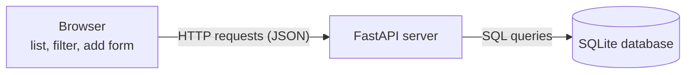
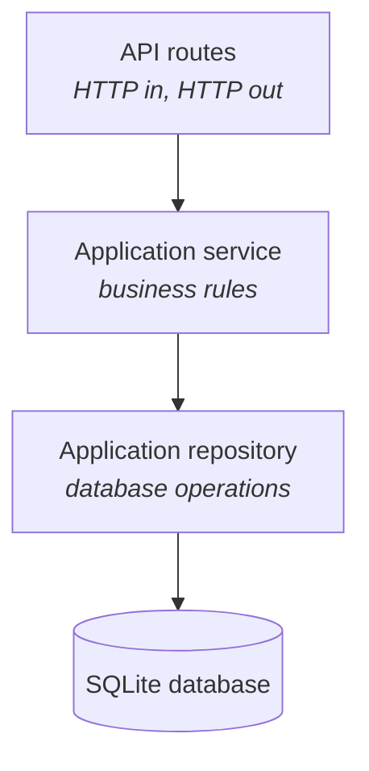
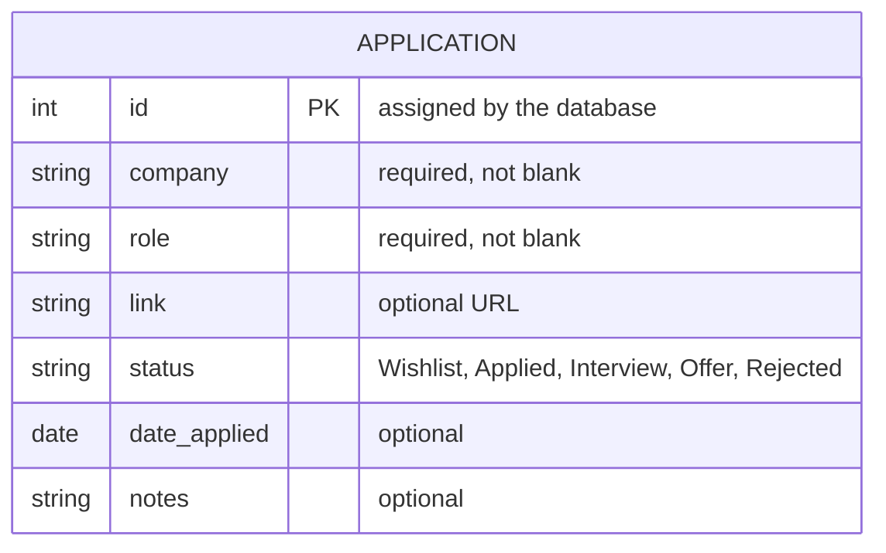
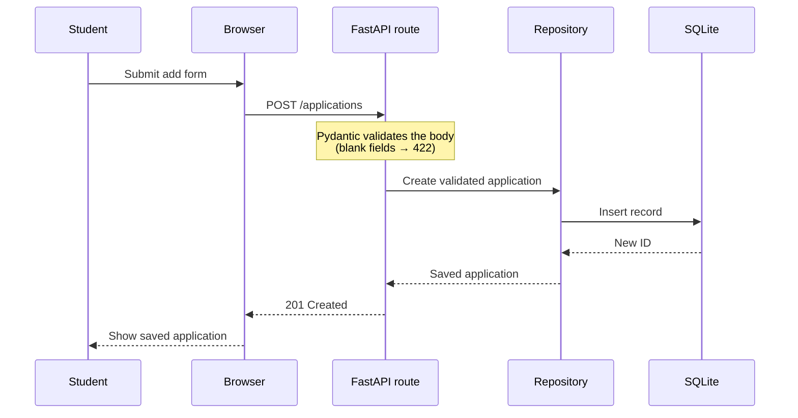

# InternTrack Architecture

Prepared by Lan Phan · November 26, 2026 · Draft for review

This document describes how InternTrack is structured: the system tiers, the layers inside the backend, how a request moves through them, and the decisions behind that design. It covers the first release described in the [project proposal](proposal.md) and notes where later features will fit.

## Contents

1. [Goals and constraints](#1-goals-and-constraints)
2. [System architecture](#2-system-architecture)
3. [Backend architecture](#3-backend-architecture)
4. [API design](#4-api-design)
5. [Data model](#5-data-model)
6. [One request through the system](#6-one-request-through-the-system)
7. [Validation and error handling](#7-validation-and-error-handling)
8. [Repository structure](#8-repository-structure)
9. [Testing strategy](#9-testing-strategy)
10. [Deployment](#10-deployment)
11. [Key design decisions](#11-key-design-decisions)
12. [Future work](#12-future-work)

## 1. Goals and constraints

**Goals**

- Store internship applications reliably, so records and IDs survive a restart (FR8).
- Keep each part of the backend small and testable on its own.
- Make the storage layer replaceable, so SQLite can later become PostgreSQL without changing routes.
- Leave a clear place for the later skill comparison feature without building it now.

**Constraints**

- Single user, no login in the first release. A public deployment must use sample data or add access control.
- Solo project, so the design favors few moving parts over flexibility that isn't needed yet.

## 2. System architecture



InternTrack is a **client–server, three-tier architecture**:

| Tier | Responsibility |
| --- | --- |
| Browser | Shows applications, collects input, and displays errors |
| FastAPI server | Validates requests and handles application operations |
| SQLite database | Stores records across restarts |

The browser talks only to FastAPI, and only FastAPI talks to the database. The browser never accesses the database directly, so every write passes through the same validation.

## 3. Backend architecture

Within FastAPI, the code is split into **layers** so each part has one clear job. Each layer calls only the layer directly below it.



| Layer | Knows about | Does not know about |
| --- | --- | --- |
| Routes | URLs, status codes, request and response schemas | SQL or how records are stored |
| Service | Rules for applications, such as the default status | HTTP |
| Repository | SQL, connections, and mapping rows to objects | HTTP or business rules |

- **Routes** define URLs such as `POST /applications` and return HTTP responses.
- **Service** handles rules that apply to applications. It stays small: a route may call the repository directly until there is a real rule to enforce, rather than adding a service that only passes calls through.
- **Repository** contains the database operations: `create`, `get`, `list`, `update`, and `delete`.

The **repository pattern** fits inside this layered design. Strict MVC isn't needed for a JSON API. If HTML templates are added later, they will serve as the view.

## 4. API design

All endpoints exchange JSON. FastAPI publishes interactive documentation at `/docs`.

| Method | Path | Purpose | Success | Errors | Story |
| --- | --- | --- | --- | --- | --- |
| `GET` | `/health` | Liveness check for hosting | 200 | | |
| `POST` | `/applications` | Create an application | 201 | 422 | US-01 |
| `GET` | `/applications` | List applications, optionally `?status=Applied` | 200 | 422 | US-02, US-04 |
| `GET` | `/applications/{id}` | Get one application | 200 | 404 | US-03 |
| `PUT` | `/applications/{id}` | Replace an application's fields | 200 | 404, 422 | US-05 |
| `DELETE` | `/applications/{id}` | Delete an application | 204 | 404 | US-06 |

`/health` exists today. The `/applications` endpoints are the planned contract for the CRUD work.

## 5. Data model

One table, `applications`, holds the first release.



- `status` defaults to **Wishlist** when omitted (US-01).
- IDs come from SQLite's `INTEGER PRIMARY KEY`, so they stay unique and stable across restarts (US-07).
- Request and response schemas live in `app/models.py` as Pydantic models, separate from the table definition.

## 6. One request through the system

Adding an internship application:



## 7. Validation and error handling

| Situation | Where it is caught | Response |
| --- | --- | --- |
| Blank company or role, unsupported status, bad date | Pydantic schema at the route | 422 with field-level details |
| Unknown application ID | Repository returns nothing, route raises | 404 `{"detail": "Application not found"}` |
| Database error | Not handled per route | 500, logged on the server |

Validation happens once, at the edge, so the service and repository can trust their input. Invalid updates never reach the database, which leaves the old values intact (US-05).

## 8. Repository structure

```text
interntrack/
├── app/
│   ├── main.py               # Create the FastAPI app
│   ├── models.py             # Request and response schemas
│   ├── routes/
│   │   └── applications.py   # HTTP endpoints
│   ├── services/
│   │   └── applications.py   # Application rules, when needed
│   └── repositories/
│       └── applications.py   # Database access
├── tests/
├── docs/
│   ├── proposal.md
│   └── architecture.md
└── README.md
```

This is the **target structure**, not a requirement to create every file today. The first CRUD implementation can keep records in memory; the database and repository files are added when the project reaches persistence.

## 9. Testing strategy

| Level | Tool | What it checks |
| --- | --- | --- |
| API tests | pytest and FastAPI `TestClient` | Every endpoint, including 404 and 422 cases from the acceptance criteria |
| Repository tests | pytest with a temporary SQLite file | CRUD operations and that records survive reopening the database (FR8) |
| CI | GitHub Actions | Runs the test suite on every pull request |

Each test gets its own database, so tests never depend on each other or on local data.

## 10. Deployment

| Environment | Runtime | Database |
| --- | --- | --- |
| Local | `uvicorn app.main:app --reload` | SQLite file |
| Public demo | Container on IBM Cloud, subject to service limits and cost review | PostgreSQL, or SQLite on persistent storage |

Containers on most cloud platforms have a temporary file system, so a SQLite file inside the container would be lost on redeploy. The public demo therefore needs either a managed database or a mounted volume. Because the first release has no login, the demo uses sample data only.

## 11. Key design decisions

| Decision | Reason | Trade-off |
| --- | --- | --- |
| FastAPI | Typed request validation and generated API docs with little code | Less built in than Django (no admin, no ORM by default) |
| SQLite first | No server to run, a single file, and it meets the persistence requirement | One writer at a time; fine for a single user |
| Repository pattern | Keeps SQL in one place and lets storage change without touching routes | One extra layer to maintain |
| Thin service layer | Adds structure only where there are real rules | Routes and services may look uneven early on |
| JSON API with a minimal front end | Delivers the MVP quickly; React can replace the front end later | A plainer interface in the first release |
| No authentication in release 1 | Single user and keeps scope small | Public demo must use sample data |

## 12. Future work

- **Skill comparison (US-08).** A new `skills` route and service call IBM watsonx.ai through a provider interface. Tests use a fake provider, so they stay deterministic, and a provider failure never blocks application tracking.

  ```mermaid
  flowchart LR
      R["Skills route"] --> S["Skill service"]
      S --> I{{"SkillProvider interface"}}
      I --> W["watsonx.ai provider"]
      I --> F["Fake provider (tests)"]
  ```

- **PostgreSQL.** Swap the repository's connection for PostgreSQL if the hosting platform requires it. Routes and services do not change.
- **Status history and reminders.** A `status_changes` table linked to `applications`.
- **Authentication.** Required before real data is deployed publicly.
