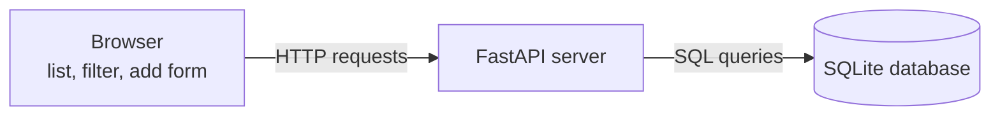
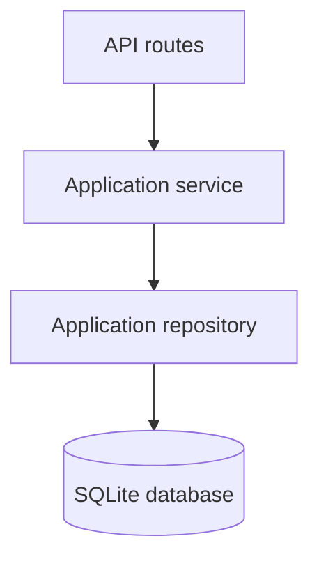
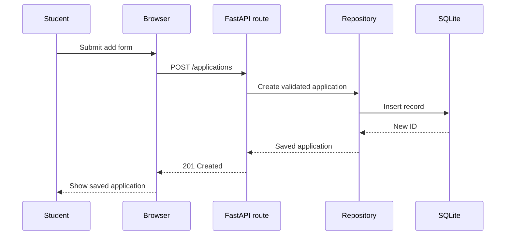

# InternTrack Architecture

## 1. System architecture



This is a **client–server, three-tier architecture**:

| Tier | Responsibility |
| --- | --- |
| Browser | Shows applications, collects input, and displays errors |
| FastAPI server | Validates requests and handles application operations |
| SQLite database | Stores records across restarts |

The browser should talk to FastAPI, and FastAPI should talk to the database. The browser should never access the database directly.

## 2. Backend architecture

Within FastAPI, use **layers** so each part has a clear job:



- **Routes** define URLs such as `POST /applications` and return HTTP responses.
- **Service** handles rules that apply to applications. Keep it small; don't create a large service class just to pass calls through.
- **Repository** contains the database operations, such as `create`, `get`, `list`, `update`, and `delete`.

The **repository pattern** fits inside this layered design. You don't need strict MVC for a FastAPI API. If you later add HTML templates, they will serve as the view.

## 3. Suggested repository structure

```text
interntrack/
├── app/
│   ├── main.py               # Create the FastAPI app
│   ├── models.py             # Request and response schemas
│   ├── routes/
│   │   └── applications.py   # HTTP endpoints
│   ├── services/
│   │   └── applications.py   # Application rules, when needed
│   └── repositories/
│       └── applications.py   # Database access
├── tests/
├── docs/
│   └── architecture.md
└── README.md
```

This is the **target structure**, not a requirement to create every file today. The current in-memory CRUD code can be the first implementation; database and repository files will be added when we reach persistence.

## 4. One request through the system

When you add an internship application:


